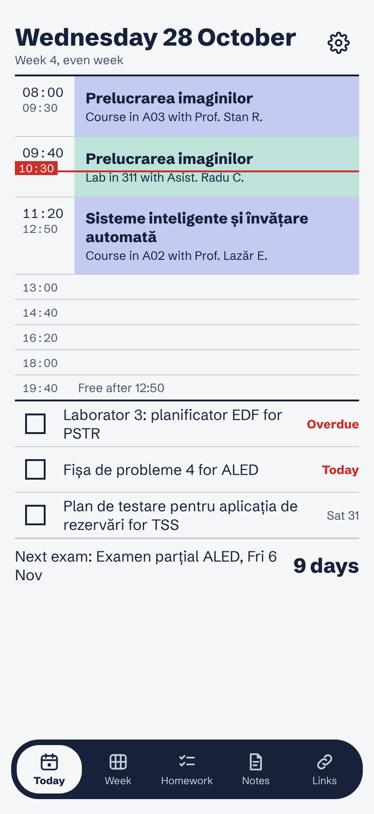
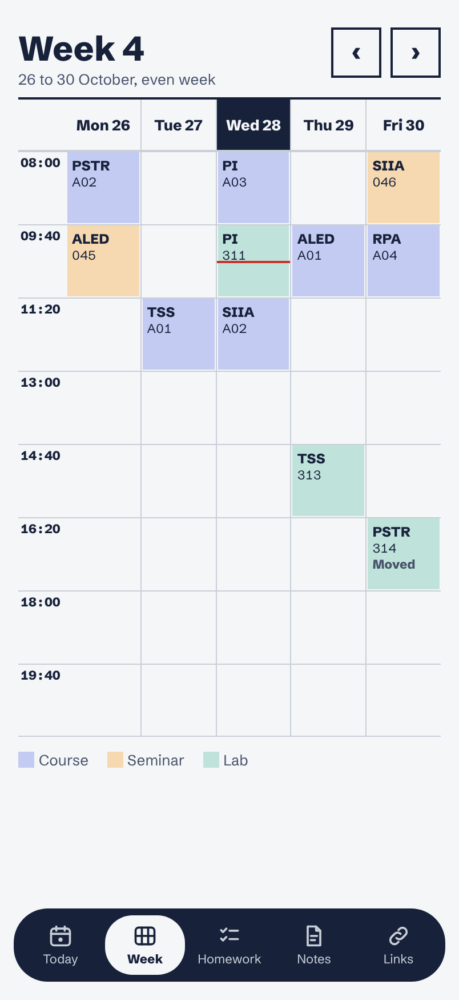
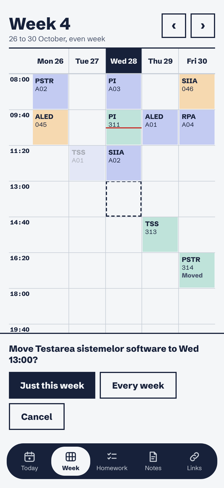
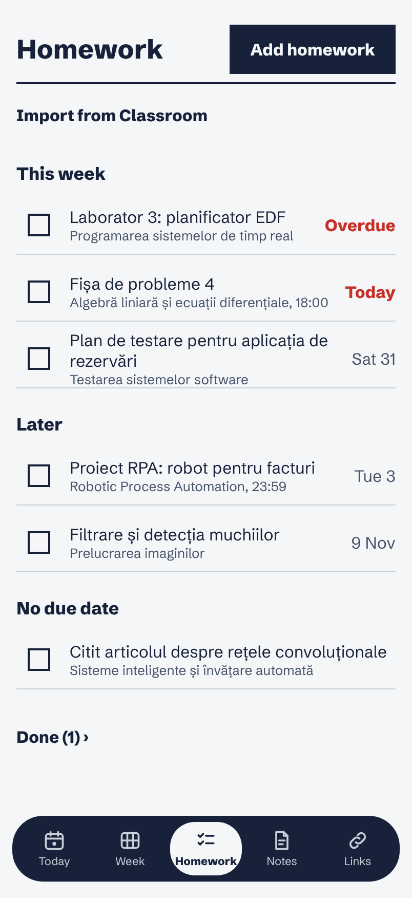
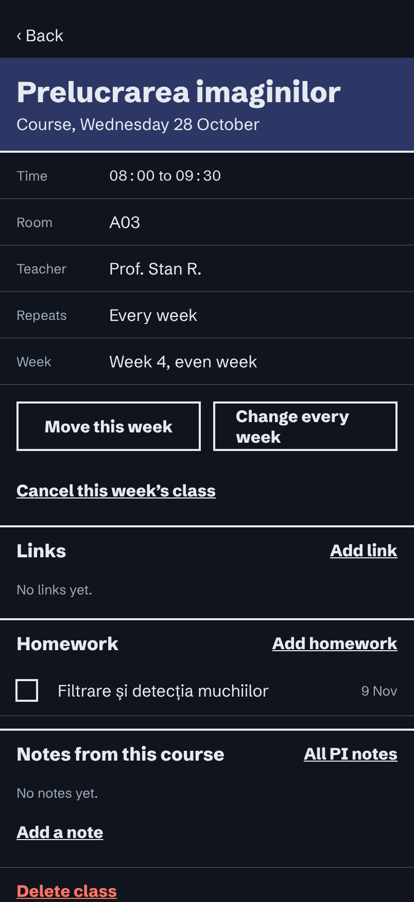
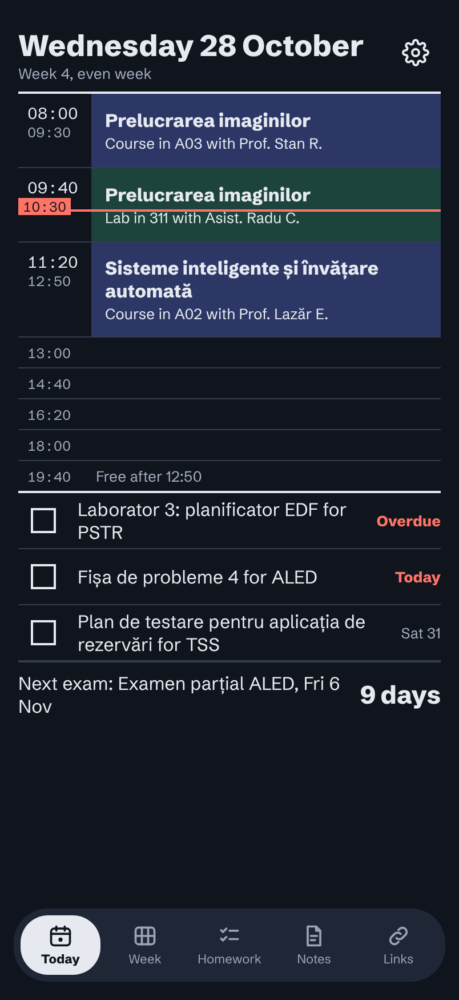

# Study Planner

A timetable, homework and exam planner for university students. It started from the timetables at the West University of Timișoara (UVT) and Politehnica Timișoara. It is a web app that you install on your iPhone, iPad or laptop, and your data syncs between devices through your Google account.

<p align="center">
  
  
  
</p>
<p align="center">
  
  
  
</p>

<p align="center"><sub>Screenshots from the built-in demo (<code>npm run demo</code>), made-up data.</sub></p>

## What it does

- **Today:** the day's classes in the university's time slots, with a live "now" line, the next exam, and the homework due this week.
- **Week:** a grid of courses, seminars and labs.
  - **Odd and even weeks:** week 1 is odd, breaks don't count, and any week can be overridden.
  - **Drag and drop:** press and hold a class, drag it to another day or slot, then choose **Just this week** or **Every week**.
- **Class page:** move or cancel one week, or change the class every week from a given date. Each class also shows its links, homework and notes.
- **Homework:** grouped into this week, later, no due date and done. Overdue and today are highlighted.
- **Exams, notes and links:** notes can belong to a subject or to a single class. Links can be general (portal, Classroom) or belong to a subject.
- **Only your classes:** turn off optional subjects you don't attend, and they disappear everywhere.
- **Import a timetable from a photo or PDF:** the app gives you a prompt. You paste it into the Claude app with your timetable, then paste the answer back. You review every class before anything is saved. Re-importing only changes what changed. It works with a free Claude account, with no API key.
- **Import homework from Google Classroom:**
  - **Reading:** read-only access to your assignments, from any Google account.
  - **What comes in:** due times are converted to Romanian time, and assignments you turned in are marked done. Last year's courses are hidden.
  - **Repeat imports:** importing again never creates duplicates and never overwrites your own edits without asking.
- **Add to calendar:** exports your classes and exams as an `.ics` file for Apple Calendar or Google Calendar.
- **Phone-friendly:**
  - installable from Safari ("Add to Home Screen") and works offline;
  - follows the phone's light or dark appearance;
  - native date and time pickers;
  - respects Reduce Motion;
  - backup and restore to a file.

## Try it

The demo runs the full app with a made-up semester. It needs no account or Firebase, and nothing is saved.

```sh
cd planner
npm ci
npm run demo      # opens the web app with sample data
```

To run it with your own data, see [planner/README.md](planner/README.md). It covers the Firebase project, sign-in, deploying to Firebase Hosting, installing on iPhone, and the timetable and Classroom imports.

## How it's built

| | |
|---|---|
| App | Expo SDK 58, React Native 0.88 with react-native-web, Expo Router, TypeScript (strict) |
| Data | Firebase Auth (Google sign-in) and Firestore with offline persistence. Each user's data lives under `users/{uid}`. |
| Sync model | Records are merged by last write (each has an `updatedAt`). Deleted records are kept as tombstones, so a delete on one device wins over an old copy on another. Security rules require every update to be newer than the stored copy. |
| Offline and install | A service worker caches the app shell. The cache is versioned on every build, and Firestore keeps its own offline copy. |
| Tests | Jest and React Native Testing Library: about 860 unit and screen tests, plus Firestore security-rules tests that run in the Firebase emulator (`npm run test:rules`) |

The code is split into layers:

```
planner/
  app/            screens (Expo Router): tabs, class, homework, exams, notes, links, import, settings
  src/domain/     pure logic, no UI or Firebase: sessions and week parity, edits, selectors,
                  import parsing/planning/diff, Classroom import, .ics export, backup
  src/data/       repositories (Firestore and in-memory), auth, Classroom API, file export
  src/ui/         shared components, theme (light/dark), motion
  firestore.rules security rules (tested in rules-tests/)
docs/superpowers/ the design spec and the implementation plan for each phase
```

The domain layer is plain TypeScript, so most of the behaviour can be tested without rendering. Examples are odd and even weeks, a class moved into a break, a UTC due time becoming a Bucharest date, and a Classroom re-import that meets your own edits.

## How it was made

The app was designed and built with [Claude Code](https://claude.ai/code). Each feature went through the same steps:

1. a brainstorm and a written design spec;
2. a step-by-step implementation plan;
3. building it test-first, with each task reviewed;
4. a review of the whole branch;
5. testing on a real iPhone.

The spec and the plans are in [`docs/superpowers`](docs/superpowers).

## Roadmap

- A native iOS app with reminders and widgets (for homework and exams)
- Sharing a timetable with classmates

## License

[MIT](LICENSE) © 2026 Cristian Dragan
